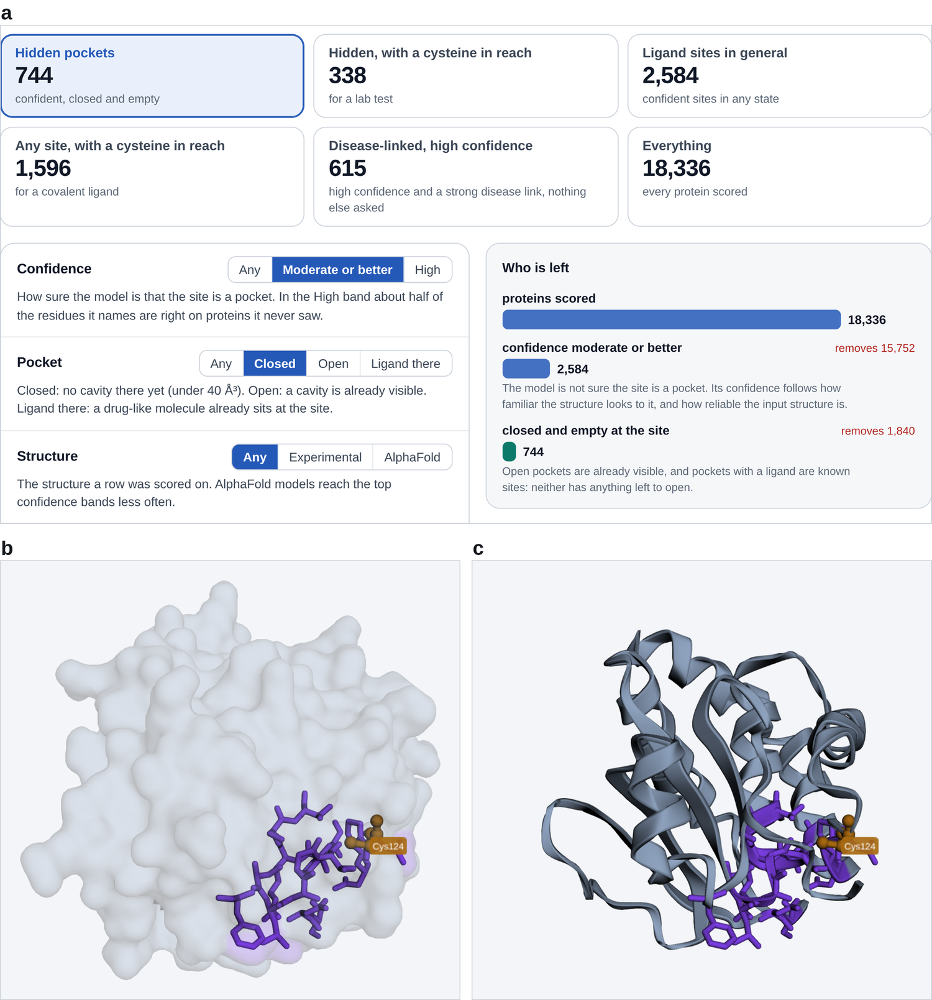

# Cryptic Pocket Catalogue

**Live site: https://pretham42.github.io/Cryptic-Pocket-Catalogue/**

*The catalogue (a), one protein in 3D (b), and the same protein in a simulation at its first (c) and most open (d) frame.*

A website that shows where proteins may hide a drug pocket. A cryptic pocket is closed in the structures we have and only opens when a drug arrives, so docking and screening usually miss it. This catalogue predicts where such pockets are in 18,336 human proteins and helps you find the ones worth a closer look. Everything on it is a prediction or a simulation. It points to places worth testing, and nothing here shows that a pocket is real or that a molecule binds.

## What you can do

- **Narrow the list like a funnel.** Pick a starting list (the hidden pockets, hidden pockets or any confident site with a cysteine in reach, the disease-linked proteins, or everything), then switch on filters.
  - **Confidence** is how sure the model is that the site is a pocket.
  - **Pocket** is whether the site is closed (no cavity yet), open (a cavity is already visible) or already holds a drug-like molecule.
  - **Strong disease link** keeps proteins whose gene is strongly tied to a disease.
  - **Not a recessive-disease gene** drops proteins behind recessive diseases, which usually come from a missing or broken protein that a pocket drug rarely fixes.
  - **Not already drugged** keeps proteins with no approved drug or potent compound yet.
  - **A cysteine in reach** keeps proteins with a free native cysteine whose sulfur lies within 4.5 angstroms of a pocket residue. A lab can use it to test the pocket, and a chemist can aim a covalent drug at it. It is geometry only. The KRAS drug sotorasib bonds to a cysteine that a cancer mutation creates, so this filter does not look for that kind.
  - **A cysteine measured ligandable** keeps those where a cysteine in reach was found ligandable in lysate chemoproteomics (CysDB). About a quarter of cysteines were measured; the rest are unknown, not unreactive.
- Use the tabs at the top: Screen (the title and the filters), Mutations (cancer mutations that add a reactive residue at a pocket), Simulations and Trust.
- Click a row to open the protein in 3D. The predicted pocket is violet.
- Watch real simulations of ten runs. Each one shows the pocket at the start and at its most open moment.
- Look at an exploratory docking example for TRIB1, a protein linked to acute myeloid leukaemia.

## Data and credits

Structures come from the RCSB Protein Data Bank and the AlphaFold Protein Structure Database. Sequences and annotations come from UniProt. Disease links come from Open Targets and development levels from Pharos. The 3D viewer is 3Dmol.js. Please follow each source's own terms of use.

## About

Independent research project from 2026. Website and code built with the help of Claude Code.
